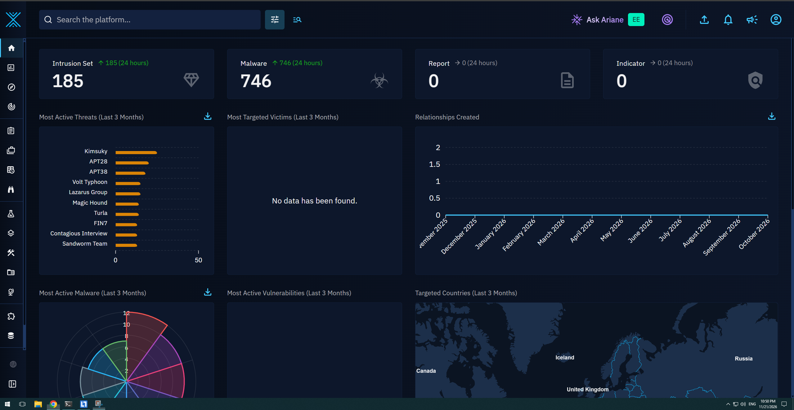
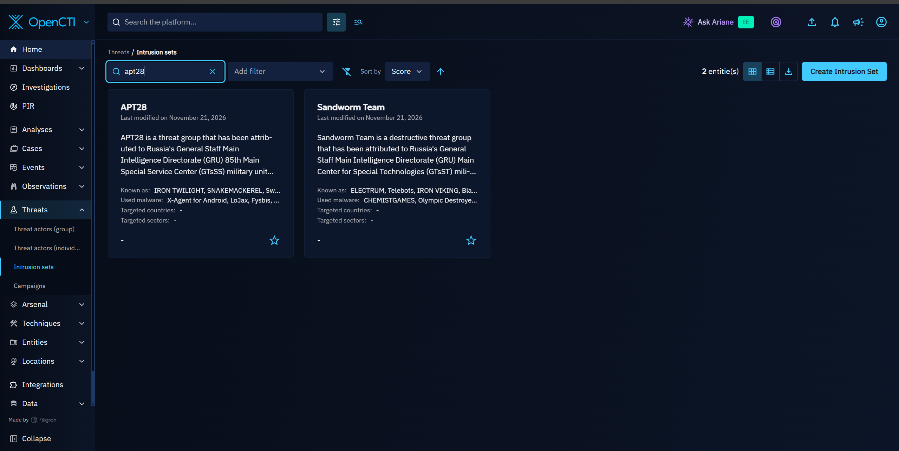
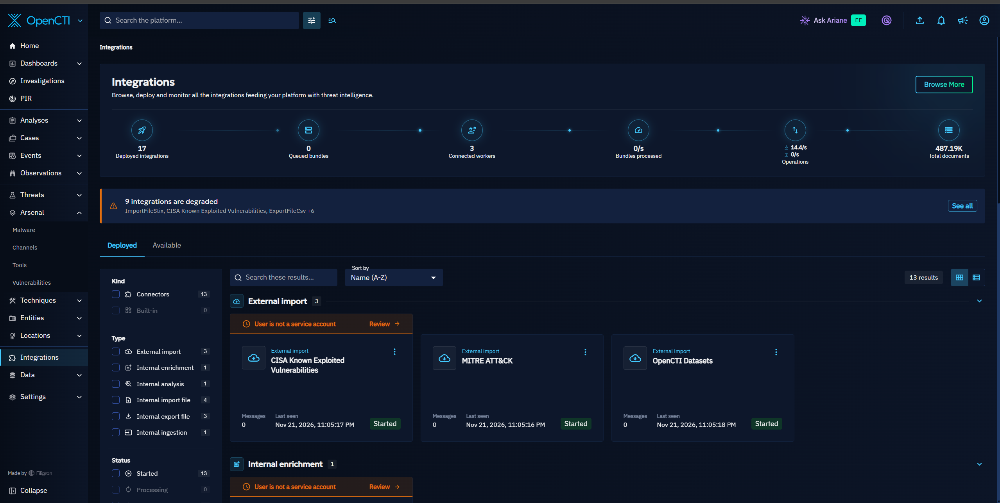

# xtm-csm-playbook

I'm applying for a Customer Success role at Filigran, so I set up OpenCTI and XTM One locally to see the platform from the customer's side, then wrote down how I'd onboard and grow an account on it.

I'm not a threat intel analyst. My background is enterprise customer success and retention in B2B SaaS. This is me learning the product.

## What I ran

- The official [OpenCTI Docker stack](https://github.com/OpenCTI-Platform/docker) on Windows (Docker Desktop + WSL2 Ubuntu)
- OpenCTI + XTM One, both Community Edition
- MITRE ATT&CK connector (comes with the stack) + the CISA Known Exploited Vulnerabilities connector, which I added
- [`setup-opencti.sh`](setup-opencti.sh) and [`docker-compose.override.yml`](docker-compose.override.yml) are here if you want to reproduce it

Shortly after it booted: 17 integrations, 3 workers, ~487K documents processed, 189 intrusion sets, 746 malware, ~1.3K attack patterns, ~1.8K vulnerabilities.

The first thing I looked up was APT28 and Sandworm. Both are attributed to Russia's GRU and both have gone after Georgia, which is where I live.

## Stuff that tripped me up

**1. Docker on Windows took more fiddling than OpenCTI itself.** WSL integration was off in Docker Desktop, then I got permission denied on the docker socket, and Elasticsearch needs `vm.max_map_count` raised first (on Windows that means editing `.wslconfig`). None of the error messages tell you the fix. A self-hosted customer would hit the same wall before they ever see the UI, so I'd send a prerequisites checklist before kickoff.

**2. My own script broke the CISA connector.** `.env.sample` doesn't end with a newline, so the connector ID I appended got glued onto the last line. Everything else looked healthy, but the CISA connector was stuck in a restart loop. I caught it from the compose warning (`CONNECTOR_CISA_ID variable is not set`) and `docker compose ps`. Takeaway: "the platform is up" doesn't mean "the data is flowing". Check connectors first.

**3. "9 integrations are degraded: User is not a service account."** By default every connector runs on the admin token. It all still works, but every imported object shows `admin` as the creator, so you can't tell which feed created what. In production I'd want one service account per connector from day one.

**4. Lots of data, not much value yet.** The home dashboard shows 0 reports, 0 indicators and "Most targeted victims: No data found". Targeted countries are blank on the actor cards, and the KEV CVEs have no CVSS severity. MITRE + KEV tell you who the attackers are and how they work, but not what to block. A real customer needs an indicator feed, some enrichment and their own reports, and which ones depends on what they actually care about. There's a whole PIR (priority intelligence requirements) section in the sidebar for this, which is where I'd start the week-2 conversation.

**5. Community vs Enterprise.** The "Ask Ariane" AI assistant in OpenCTI is EE. XTM One CE connects to OpenCTI fine, but Chat, Value, Presentations and all of Agent Studio are locked. Value and Presentations sound like exactly the things a CSM would use for business reviews, so that's an obvious expansion conversation.

More screenshots: [attack patterns](screenshots/03-attack-patterns.png) · [intrusion sets](screenshots/04-intrusion-sets.png) · [vulnerabilities](screenshots/06-vulnerabilities.png) · [XTM One](screenshots/07-xtm-one.png)

## How I'd run an account on this

My understanding of the suite so far:

- **OpenCTI:** threat intel platform; everything is stored as STIX 2.1
- **OpenAEV:** attack simulations based on that intel (used to be OpenBAS)
- **OpenCRQ:** cyber risk quantification, not released yet
- **XTM One:** the AI agent layer that ties them together

**First 30 days**
- Figure out who actually matters: the exec sponsor (usually the CISO), the CTI lead, the SOC lead, and whoever owns the servers
- Agree on 2–3 goals in writing, e.g. "cut the time from a new threat to a detection rule"
- Prerequisites and sizing check before install (see #1)
- Connectors healthy, service accounts set up, one real workflow live
- Aim for something genuinely useful in the platform within the first month

**Health signals I'd watch**
- Connectors erroring or data going stale
- Weekly active analysts dropping
- No SIEM/EDR integration after a couple of months
- The sponsor stops showing up to reviews
- Self-hosted and several versions behind

**Business reviews:** recap the goals, what changed in their threat landscape, usage, value in *their* numbers (analyst hours saved, time to detection, exposures fixed), what's new on the roadmap, and next quarter's plan. The value numbers come from the customer, not from me, or they won't survive a CFO.

**When to bring up another module**
- Heavy CTI use + the board asking "are we covered against X?" → OpenAEV
- The CISO has to justify budget in money → OpenCRQ
- Analysts drowning in manual enrichment and reporting → XTM One

**Things I'd worry about:** one champion who might leave (so build several relationships early), "why pay when it's open source?" (so make enterprise value visible in every review), and connecting every feed at once until nobody can find anything useful.

## Links

[OpenCTI docs](https://docs.opencti.io/latest/) · [Docker stack](https://github.com/OpenCTI-Platform/docker) · [XTM One](https://filigran.io/platform/xtm-one/) · [OpenCRQ](https://filigran.io/products/opencrq) · [MITRE ATT&CK](https://attack.mitre.org/) · [CISA KEV](https://www.cisa.gov/known-exploited-vulnerabilities-catalog)
